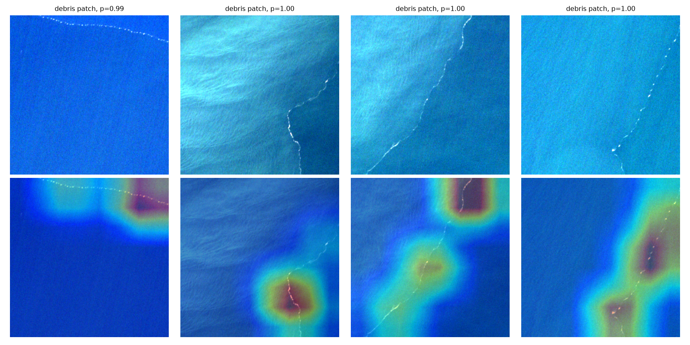

# Marine Debris Detection from Satellite Images

Does a Sentinel-2 satellite patch contain **floating marine debris**? A ResNet-18, pretrained on ImageNet and adapted to all **11 spectral bands**, answers this for 256×256 patches of the [MARIDA](https://marine-debris.github.io/) dataset.

**Test set (359 patches, 101 with debris), MARIDA's official split:**

| | Accuracy | Debris precision | Debris recall | Debris F1 | ROC-AUC |
|---|---|---|---|---|---|
| Always predict "no debris" (baseline) | 71.9% | — | 0% | — | 0.5 |
| **ResNet-18, 11 bands** | **87.2%** | **0.76** | **0.80** | **0.78** | **0.91** |

It finds 81 of the 101 debris patches, with 26 false alarms out of 258 clean patches.

### Where does the model look? (Grad-CAM)
Top row: true-color view of test patches that contain debris. Bottom row: Grad-CAM heatmap. The model focuses on the thin debris lines, not on open water or wave texture.



## Data
[MARIDA](https://zenodo.org/records/5151941) (Kikaki et al., 2022): 1,381 Sentinel-2 patches (256×256 px, 11 bands) from coastal areas around the world, with official train / validation / test splits (694 / 328 / 359). Each patch has multi-label annotations; this project predicts the **Marine Debris** label. 27% of training patches contain debris.

## Method
- **Input** (`src/dataset.py`): the full 11-band reflectance image for each patch, normalized per band using training-set statistics. Augmentation: random 90° rotations and flips (satellite images have no "up").
- **Model** (`src/model.py`): ImageNet ResNet-18. The first convolution is rebuilt for 11 input channels: the blue, green and red bands reuse the matching pretrained RGB filters, and the other 8 bands start from their average. A single output gives the probability of debris.
- **Training** (`src/train.py`): AdamW, cosine learning-rate schedule, 25 epochs on an Apple M5 GPU (about 12 minutes). Debris patches are weighted up in the loss to offset the class imbalance.
- **Evaluation:** the checkpoint with the best validation F1 is kept, the decision threshold (0.60) is also tuned on validation, and the test set is scored once at the end.
- **Explainability** (`src/gradcam.py`): Grad-CAM on the last ResNet block, implemented with forward/backward hooks.

## Run it
```bash
pip install -r requirements.txt
# download MARIDA.zip from https://zenodo.org/records/5151941 and unzip it to ./data/MARIDA
python src/train.py --data data/MARIDA --out results
python src/gradcam.py --data data/MARIDA --ckpt results/best.pt --out results/gradcam.png
```
`results/metrics.json` has the full test metrics, confusion matrix and per-epoch history.

## History: what was wrong with the first version
The notebooks in `notebooks/` are the original coursework version, and they had a data bug. The loader picked up files ending in `_conf.tif` (annotator-confidence masks) from 11 *different* patches and stacked them as if they were the 11 bands of one image. It read the label from a GeoTIFF tag that doesn't exist, so every label was 0. Training "reached 100% accuracy" in 3 epochs because there was only one class to predict.

The rebuilt pipeline reads each patch's real 11-band image (`S2_<date>_<tile>_<n>.tif`), takes labels from `labels_mapping.txt`, uses the official splits, and compares against a majority-class baseline. The lesson: a perfect score is a bug until proven otherwise.
